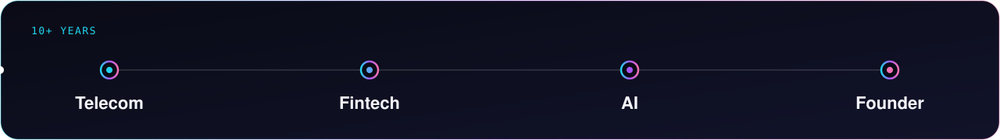

  

  10+ years building data infrastructure and distributed systems across telecom, fintech and AI. 
  From ETL pipelines to cloud-native architectures: reliable, scalable, and useful for real decisions.

  

## Now

<table>
  <tr>
    <td width="50%"></td>
    <td width="50%"></td>
  </tr>
</table>

Also maintaining production data pipelines at Koltin: `Airbyte → dbt → Dagster → PostgreSQL`.

## What I do

<table>
  <tr>
    <td width="50%"></td>
    <td width="50%"></td>
  </tr>
  <tr>
    <td width="50%"></td>
    <td width="50%"></td>
  </tr>
  <tr>
    <td width="50%"></td>
    <td width="50%"></td>
  </tr>
</table>

## Open source

<table>
  <tr>
    <td width="50%"></td>
    <td width="50%"></td>
  </tr>
</table>

## Stack

  
  
  
  
  
  
  
  
  
  
  
  
  
  

 

  

